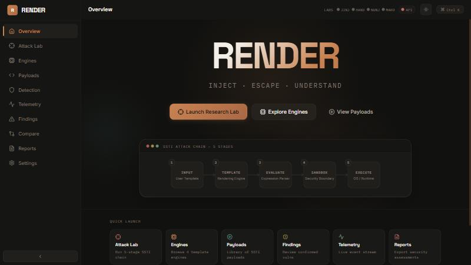
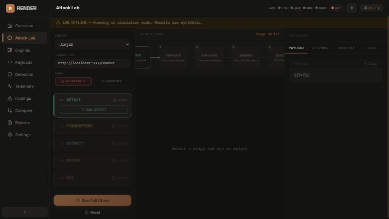
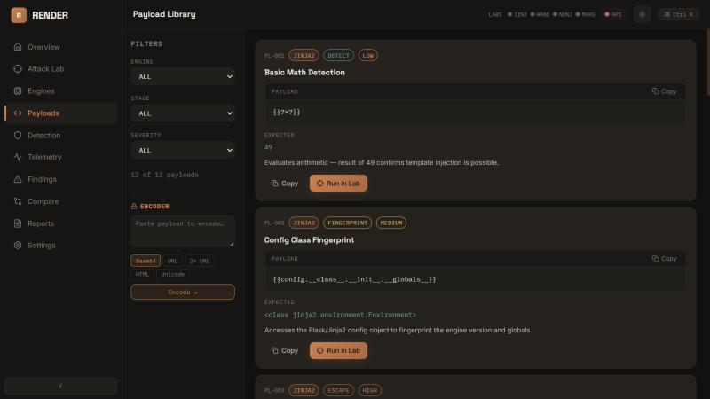
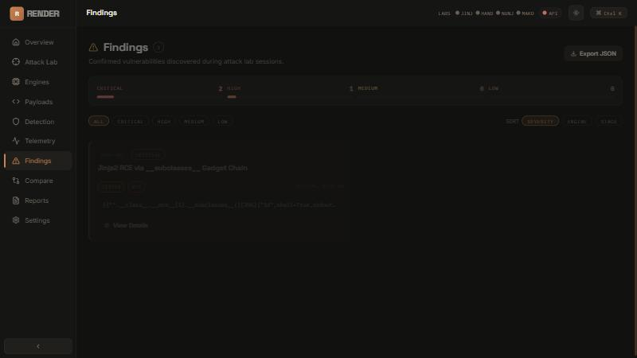
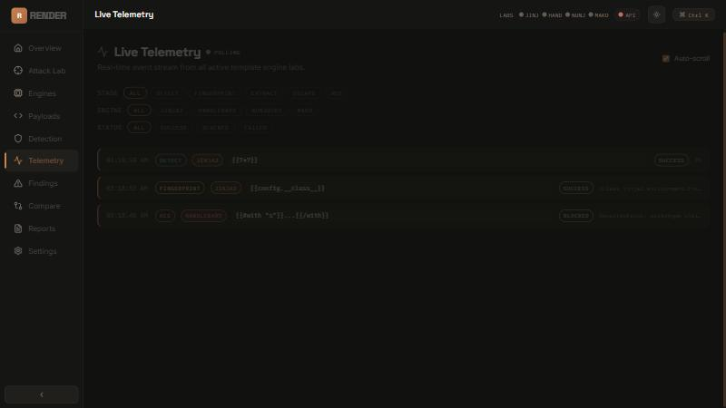

<div align="center">

# RENDER

### Server-Side Template Injection · Research Platform

*Inject · Escape · Understand*

[](https://www.python.org/)
[](https://fastapi.tiangolo.com/)
[](https://react.dev/)
[](https://www.typescriptlang.org/)
[](https://vitejs.dev/)
[](LICENSE)

</div>

---

**RENDER** is an offline-first Server-Side Template Injection (SSTI) research platform for security professionals and researchers. It provides a structured, five-stage attack laboratory with real exploit execution across four major template engines — Jinja2, Handlebars, Nunjucks, and Mako — alongside a complete findings management and reporting workflow.

> **Educational use only.** This platform is designed for authorized security research, CTF challenges, and learning. Use it only against systems you own or have explicit permission to test.

---

## Screenshots

<table>
<tr>
<td align="center" width="50%">

**Overview**



*Hero dashboard with attack chain visualization and quick-launch grid*

</td>
<td align="center" width="50%">

**Attack Lab**



*5-stage SSTI chain — DETECT → FINGERPRINT → EXTRACT → ESCAPE → RCE*

</td>
</tr>
<tr>
<td align="center" width="50%">

**Payload Library**



*Categorized payload arsenal with severity indicators and encoder*

</td>
<td align="center" width="50%">

**Findings**



*Confirmed vulnerability tracking with severity distribution*

</td>
</tr>
<tr>
<td align="center" colspan="2">

**Live Telemetry**



*Real-time event stream with stage/engine badges and duration metrics*

</td>
</tr>
</table>

---

## Features

### Attack Laboratory
- **5-stage SSTI chain** — DETECT → FINGERPRINT → EXTRACT → ESCAPE → RCE — with automated progression
- **Vulnerable vs. Hardened mode** — switch on the fly to see the difference real mitigations make
- **4 template engines** — Jinja2, Handlebars, Nunjucks, Mako with engine-specific payload routing
- **Payload Inspector** — live request/response panel with one-click copy for every stage

### Payload Intelligence
- **Curated payload library** categorized by engine, stage, and severity
- **Built-in encoder** — URL, Base64, HTML entity encoding for WAF evasion research
- **Expected-result annotations** explaining what each payload aims to achieve

### Findings & Telemetry
- **Findings tracker** — save confirmed vulnerabilities with impact, evidence, and remediation
- **Severity distribution** — visual breakdown of CRITICAL / HIGH / MEDIUM / LOW findings
- **Live telemetry stream** — real-time event log with stage, engine, duration, and response preview

### Detection Rules
- Signature-based SSTI detection rules with CVSS scoring
- Stage-tagged triggers and evidence examples
- Remediation guidance per rule

### Engine Explorer
- Deep-dive cards for each engine: syntax, fingerprinting patterns, escape examples
- Lab online/offline status for each engine

### Vulnerable vs. Hardened Compare
- Side-by-side diff view for the same payload across both modes
- Code snippet diff showing exactly which countermeasure blocked the attack

### Reports
- **Generate full markdown reports** from attack session data
- Engine filter, findings inclusion, and telemetry toggle
- One-click copy to clipboard; expandable inline preview

### Platform
- **Command palette** (Ctrl+K) for instant navigation
- **Light / dark theme** toggle — Obsidian + Copper dark, Warm Ivory light
- **Configurable API URL** in Settings (no rebuild needed)
- Responsive layout with collapsible sidebar

---

## Architecture

```
render/
├── api/                    # FastAPI backend
│   └── main.py             # All endpoints, attack engine, in-memory state
├── frontend/               # React + TypeScript + Vite
│   └── src/
│       ├── api/            # Axios client with dynamic baseURL
│       ├── components/
│       │   ├── attack/     # StageCard, PayloadInspector, AttackFlowViz
│       │   ├── layout/     # Sidebar, Header, CommandPalette
│       │   └── ui/         # Button, Card, Badge, StatusDot, EmptyState
│       ├── pages/          # Landing, Lab, Engines, Payloads, Detection,
│       │   │                 Telemetry, Findings, Compare, Reports, Settings
│       ├── stores/         # Zustand — uiStore, labStore, attackStore
│       └── types/          # Shared TypeScript interfaces
└── docs/screenshots/       # Platform screenshots
```

**Backend** — FastAPI serves a single `main.py` with all endpoints. Attack execution is simulated server-side with realistic response payloads per engine and stage, giving consistent demo data without requiring live template-engine processes. The in-memory state (`_findings`, `_telemetry`, `_reports`) resets on restart — this is by design for a research sandbox.

**Frontend** — React 18 + TypeScript + Vite with Framer Motion for page and card transitions. Global state via Zustand. Axios request interceptor reads `apiBaseUrl` from `uiStore` on every request, so the Settings page's API URL field takes effect immediately without a page reload.

---

## Tech Stack

| Layer | Technology |
|-------|-----------|
| Backend runtime | Python 3.11 + FastAPI + Uvicorn |
| Frontend framework | React 18 + TypeScript |
| Build tool | Vite 5 |
| Styling | CSS custom properties (design-token system) |
| Animation | Framer Motion |
| State management | Zustand |
| HTTP client | Axios |
| Icons | Lucide React |
| CORS | FastAPI middleware (dev: all origins) |

---

## Getting Started

### Prerequisites

- Python 3.11+
- Node.js 18+ and npm

### 1 — Backend

```bash
cd api
pip install fastapi uvicorn[standard] pydantic
uvicorn main:app --reload --port 8000
```

API is now running at `http://localhost:8000`. Swagger docs at `http://localhost:8000/docs`.

### 2 — Frontend

```bash
cd frontend
npm install
npm run dev
```

Frontend is now running at `http://localhost:5173` (Vite default) or `http://localhost:5176` if the default port is in use.

Open the URL in your browser. The header shows live API status — green means connected.

---

## API Reference

| Method | Endpoint | Description |
|--------|----------|-------------|
| `GET` | `/health` | API health check |
| `GET` | `/engines` | List all supported template engines |
| `GET` | `/engines/{id}/status` | Engine lab status |
| `POST` | `/attack` | Execute a single-stage SSTI attack |
| `POST` | `/attack/chain` | Run full 5-stage chain automatically |
| `GET` | `/payloads` | List payloads (filterable by engine/stage) |
| `GET` | `/detection/rules` | List detection rule signatures |
| `GET` | `/findings` | List confirmed findings |
| `POST` | `/findings` | Save a new finding |
| `DELETE` | `/findings/{id}` | Delete a finding |
| `GET` | `/telemetry` | Get telemetry event log |
| `POST` | `/telemetry/clear` | Clear telemetry |
| `GET` | `/reports` | List generated reports |
| `POST` | `/reports/generate` | Generate a new report |
| `POST` | `/compare` | Side-by-side vulnerable vs. hardened diff |
| `GET` | `/scenarios` | List predefined attack scenarios |
| `POST` | `/scenarios/run` | Execute a predefined scenario |

Full interactive docs available at `/docs` when the backend is running.

---

## SSTI Attack Chain

RENDER structures SSTI exploitation into five sequential stages:

| Stage | Goal | Example Payload (Jinja2) |
|-------|------|--------------------------|
| **DETECT** | Confirm template injection exists | `{{7*7}}` → `49` |
| **FINGERPRINT** | Identify the template engine | `{{config}}` → Flask config object |
| **EXTRACT** | Read sensitive data from context | `{{"".__class__.__mro__}}` |
| **ESCAPE** | Break out of sandbox / restrictions | `{{request.application.__globals__}}` |
| **RCE** | Achieve remote code execution | `{{"".__class__.__mro__[1].__subclasses__()[396]("id",shell=True,stdout=-1).communicate()[0]}}` |

Each stage unlocks the next — mimicking a real engagement progression where the attacker uses information from each step to advance.

---

## Design System

RENDER uses a token-based design system built on CSS custom properties. The dark theme uses an **Obsidian + Copper** palette — warm dark backgrounds with a copper brand accent — deliberately avoiding synthetic neons in favor of a sophisticated, professional aesthetic suited to security tooling.

| Token | Value | Use |
|-------|-------|-----|
| `--color-primary` | `#C98252` (copper) | Brand, buttons, links |
| `--color-critical` | `#C66B67` (muted red) | CRITICAL findings, RCE stage |
| `--color-execution` | `#B37A5A` (terracotta) | ESCAPE stage |
| `--color-detection` | `#5F9E99` (muted teal) | DETECT stage, info |
| `--color-success` | `#7FA58A` (muted sage) | Online status, EXTRACT stage |
| `--color-warning` | `#C9A35A` (muted amber) | FINGERPRINT stage, warnings |

---

## Contributing

Pull requests are welcome. For significant changes, open an issue first to discuss the approach.

```bash
# Fork and clone
git clone https://github.com/het-P301204/render.git

# Create feature branch
git checkout -b feature/your-feature

# Make changes, then push and open a PR
git push origin feature/your-feature
```

---

## License

MIT — see [LICENSE](LICENSE) for details.

---

<div align="center">

Built for security research · Not for unauthorized use

</div>
